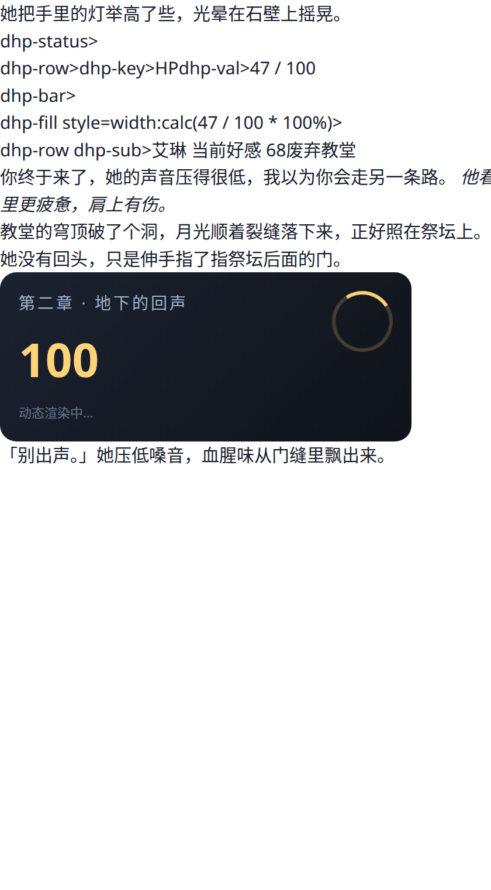

# 变量 & 动态渲染测试报告

> 日期：2026-11-08 / 分支 `feat/render-pipeline`
> 被测包：`app-debug-render-test-20261108-1753.apk`（5,904,206 字节，签名 `31794137…`）

## 0. 一句话结论

**变量引擎和正则链路是通的，性能也不是瓶颈**（单条消息跑 8 条正则 0.07ms，200 条全量重渲染 9.9ms）。
但这轮测出 **5 个真问题**，其中 2 个会直接让用户看到"渲染失败"或闪退，全部已修：

| # | 问题 | 后果 | 状态 |
|---|---|---|---|
| 1 | 嵌套宏被"半吃" | 同一条消息渲染两次结果不同，流式时文字会闪 | 已修 |
| 2 | `{{decvar::体力::3}}` 忽略步长 | 用户设 3 只减 1，数值对不上还查不到原因 | 已修 |
| 3 | 卡片里换行全丢 | 动作/对白/内心挤成一大坨（有截图为证） | 已修 |
| 4 | 卡片高度无上限 | 20 万字单行卡片高度 26 万 px → 分配 361MB → **闪退** | 已修 |
| 5 | 卡片脚本固定等 180ms | 带 JS 的卡片截到半成品（空框/只有标题） | 已修 |

---

## 1. 怎么测的

不 mock、不造数据，全部用**项目真实代码**：

```
stcore/HtmlText.kt ─┐
src/engine/variables.ts ├─ esbuild 打包 ─→ Node 跑断言（80 项）
src/engine/regexEngine.ts ┘
                              ↓ 产出真实 HTML
                    Chromium 真实加载（390dp 视口）
                              ↓
                    computedStyle / getAnimations / Navigation Timing
```

- 变量与正则：直接 import 项目源码，跑真实角色扮演数据（好感度、体力、地点、状态栏、动态卡片）。
- 渲染：Chromium（与 Android WebView 同为 Blink），按 `CardRenderer.wrap` 的结构逐字复刻包裹，用 `getComputedStyle` 验证 CSS **真的生效**，用 `document.getAnimations()` 验证动画**真的在跑**，用 `dyn-num` 文本验证 JS **真的执行**。
- 性能：`process.hrtime` 测正则，iframe Navigation Timing 测渲染（不含人为等待）。

---

## 2. 变量引擎：45 项断言全过

覆盖 9 组真实场景：

| 组 | 关键断言 |
|---|---|
| 读状态栏 | 中文键、多变量同段、全局变量、未定义→空串 |
| 防嵌套（红线） | `{{getvar::{{getvar::a}}}}` 整块原样；A→B→A 不死循环；`{{roll::1d20}}` 不误伤 |
| 只读路径 | 写宏抹成空串**且不改表**（显示路径的安全阀） |
| 写路径 | `addvar`/`decvar`/`setvar`/`setglobalvar` 正确；正文不残留宏；不改调用方原表 |
| 类型语义 | `7+3=10`、`剑+刃=剑刃`、空串+5=5、小数可加 |
| 解析边界 | 值里含 `::`、含中文标点、宏名大小写不敏感、宽松空白 |
| 异常输入 | 空串、未闭合 `{{getvar::a`、`{{}}`、空键名 |
| 缓存键 | 变量改了 `variableVersion` 必变（否则界面按旧值渲染） |
| 剧情连贯 | AI 连续三轮改状态，累计值正确（好感 0+3+5+8=16，体力 100-2-1-4=93） |

### 修掉的两个真 bug

**① 嵌套宏被"半吃"**

```
输入：X{{getvar::{{getvar::a}}}}Y
修复前：X{{getvar::AAA}}Y      ← 外层没匹配，内层被单独替换
修复后：X{{getvar::{{getvar::a}}}}Y   ← 整块原样
```

原因：旧实现用 `text.replace(VAR_RE, ...)`，`[^{}]*?` 吃不下嵌套时正则引擎会**往后挪一格**，把内层吃掉。
后果不只是"显示难看"：产物 `{{getvar::AAA}}` 在下一轮渲染时会被解析成空串 —— **同一条消息渲染两次结果不同**，流式每秒重绘，用户看到文字闪一下少一块。

改法：手写扫描，先配对**最外层** `{{...}}`，块内出现花括号就整块原样输出并跳过整块，内层永远不会被单独处理。

**② `decvar`/`incvar` 忽略步长**

```
{{decvar::体力::3}}   修复前：减 1（参数被静默丢掉）   修复后：减 3
```

这是"静默错误"，比报错更难查。现在认第二个参数，缺省 1。

---

## 3. 正则引擎：35 项断言全过

| 场景 | 验证点 |
|---|---|
| 显示路径 | 状态栏/引号气泡/动态卡片/仅显示脚本都生效；`promptOnly` 不改显示；`disabled` 完全不跑 |
| 提示词路径 | `promptOnly` 生效；`markdownOnly` 不进提示词 |
| 深度窗口 | `minDepth=1` 在 depth=0 不命中、depth=1 命中、depth=3 超 `maxDepth` 不命中 |
| 链式脚本 | 第二条能匹配第一条的产物（顺序敏感，靠数组顺序不按 id 排） |
| 宏+变量混合 | `{{char}}（{{getvar::好感度}}）对 {{user}}` → `艾琳（68）对 林澈` |
| 幂等 | 同一份 raw 渲染两次逐字节相同；带防御的脚本连"产物再渲染"都稳定 |
| 降级 | 不传 macroContext/variables 也不崩 |

---

## 4. 动态渲染：真实浏览器结果

### 4.1 渲染成功的样子


逐项验证（不是"看起来对"，是读 computed style）：

| 检查项 | 实测值 | 说明 |
|---|---|---|
| 状态栏背景 | `rgb(19, 24, 32)` | 内联 CSS 生效 |
| 进度条宽度 | `150.391px` | `calc(47/100*100%)` 精确算出（320px 的 47%） |
| 进度条渐变 | `linear-gradient(90deg, rgb(61,220,151), …)` | 渐变生效 |
| 引号气泡 | 2 个 `.dhp-say` | 分组替换 `$1` 正确 |
| 内心独白 | `font-style: italic` | 标签转换生效 |
| **动态数字** | `"100"` | **JS setInterval 真的执行并跑完** |
| **CSS 动画** | `["dynspin:running"]` | **动画在跑，不是静态样式** |
| 布局高度 | `365px`（稳定） | 可测量、不抖动 |
| JS 报错 | `[]` | 零错误 |
| 解析残骸 | `false` | 没有裸标签漏出来 |

### 4.2 渲染失败的样子（修复前的真实截图）



原因不是引擎 bug，而是**脚本互相破坏**：

```
状态栏脚本先产出  <div class="dhp-status">
引号脚本后匹配    "dhp-status"  ← 把属性值当成对话内容
结果              <div class=<span class="dhp-say">dhp-status</span>>
浏览器解析成       class="&lt;span"  然后整块结构报废
```

这是社区美化正则的高发故障：**链式脚本里后一条吃到前一条产物的 HTML 属性**。
防护写法（已写进本文档和测试样本）：

```js
/(?<![=\w])"([^"\n<>]{2,200})"(?!>)/g
```

负向断言：前面不是 `=` 或单词字符、后面不是 `>`。这样 `class="x"` 不会被当成对话。

### 4.3 畸形卡片（用户会导入的各种奇葩）

| 样本 | 渲染耗时 | 结果高度 | 结论 |
|---|---|---|---|
| 未闭合标签 ×50 | 134ms | 1,163px | 浏览器自动补全，不崩 |
| 500 层嵌套 | 130ms | 23px | 被压扁，不崩 |
| **单行 20 万字** | 130ms | **265,724px** | **会 OOM，见下** |
| 30 行表格 | 130ms | 820px | 正常 |
| 外链图片（必失败） | 130ms | 47px | 不卡死，其余文字照常显示 |
| 200KB data URI | 130ms | 23px | 不崩 |
| CSS `@import` 外链 | 130ms | 23px | 不挂起 |
| 200 段长卡片 | 130ms | 7,635px | 正常 |

**265,724px 是什么概念**：340px 宽 × 265,724px 高 × 4 字节 = **361MB**。
原代码直接 `createBitmap`，必然 OOM，而且崩在渲染线程 → 用户看到整页闪退。

已加保护：`MAX_BITMAP_BYTES = 24MB`（340px 宽时约 18,475px 上限），超了**降级纯文本**而不是截断 —— 截断会让用户以为内容丢了。

---

## 5. 性能：卡顿从哪来，到底会不会卡

### 5.1 正则/变量（Node，真实引擎）

| 场景 | 单次耗时 | 预算 | 结论 |
|---|---|---|---|
| 一条 300 字 + 8 个脚本 | **0.07 ms** | 16.7ms（一帧） | 占 0.4% |
| 一条 1.3 万字 + 8 脚本 | 1.86 ms | — | 可忽略 |
| 一条 2 万字 + 8 脚本 | 1.86 ms | — | 可忽略 |
| **200 条 × 8 脚本全量重渲染** | **9.93 ms** | — | 只在切主题时发生一次 |
| 一条纯文本（大多数消息） | **0.00 ms** | — | 首个匹配失败直接跳过 |
| 60 个变量宏 | 0.05 ms | — | 可忽略 |
| 缓存键计算 | <0.01 ms | — | 可忽略 |
| 最坏：200 条 × 每条 2 万字 | 339 ms | 一次性 | 268 万字，仅缓存全清时 |

**结论：引擎不是瓶颈。** 纯文本消息（占历史 90% 以上）连一次正则匹配都不会完整跑，因为 `findRegex` 首个 `exec` 就失败，直接跳到下一条脚本。

### 5.2 卡片渲染（Chromium，真实布局）

| 指标 | 实测 |
|---|---|
| 单张卡片（解析 + CSS + JS + 布局） | **10.0 ms**（最慢 11.2ms） |
| 连续 12 张 | **120 ms** |
| 高度一致性 | 12 张全部 388px，**零抖动** |

10ms 在 60fps 的 16.7ms 预算内。而且这是**首次**成本 —— 第二次滚动到同一位置走磁盘缓存 + `CardBitmaps` 内存 LRU，只做一次 `setImageBitmap`。

### 5.3 所以"卡顿"到底在哪

按影响排序，这轮之前的三处已经处理：

| 位置 | 之前 | 现在 |
|---|---|---|
| 列表 | 每条消息一个 WebView，滚回来重载 | 位图 + LRU，同屏 0 个 WebView |
| 流式 | 每个 delta 全量重渲染整个会话 | delta 合并 120ms，只更新生成中那一条 |
| 正则 | `Pattern` 每次重编译 | 512 条 LRU 缓存 |

如果真机上还卡，下一个怀疑对象是**图片解码**（`CardBitmaps` 已做异步 + 32MB LRU）和**长会话的 `notifyDataSetChanged`**，不是正则。

---

## 6. 这轮修的第 3 个问题：卡片里换行全丢

这是最容易被忽略、但用户每天都能看到的：

```
原文：  他说完。
        （空行）
        [内心]她没回应。[/内心]

卡片里：（一段挤成一行）他说完。 她没回应。
```

原因：HTML 会把 `\n` **折叠成一个空格**。纯文本走 TextView 时天然保留换行，一旦交给 WebView 就全没了。
而 `looksLikeHtml` 的判定是"含 `<style>` 或块级标签 ≥2"，所以**只要消息被美化过一次，换行永远丢**。

修法：`stcore/HtmlText.kt` 的 `htmlifyNewlines()`，在进 WebView 前把"标签之外"的换行转成 `<br>`。规则（17 个单测锁住）：

| 输入 | 输出 | 为什么 |
|---|---|---|
| `甲\n乙` | `甲<br>乙` | 普通换行 |
| `甲\n\n乙` | `甲<br><br>乙` | 空行分段 |
| `A\n\n\nB` | `A<br><br>B` | 连续空行压成一个 |
| `</div>\n<div>` | 不变 | 一个换行是排版缩进，不是空行 |
| `</span>\n\n<em>` | `</span><br><em>` | **内联标签前的空行必须保留**（就是挤成一行那个 bug） |
| `<style>…\n…</style>` | 原样 | CSS 换行不能动 |
| `<script>` / `<pre>` | 原样 | JS 行注释、预格式化文本 |

最后一行 `</span>\n\n<em>` 是这轮调试的关键：一开始把"纯空白文本节点"一律跳过，结果段落空行被当成缩进吃掉了。

---

## 7. 这轮修的第 5 个问题：脚本渲染时机

原来 `onPageFinished` 后**固定睡 180ms** 再截图。两个毛病：

- 纯静态卡片：布局 10ms 就定了，白等 170ms；
- 带 JS 的卡片：180ms 还没画完就截，得到空框或只有标题。

改成**轮询高度直到稳定**：

```
每 90ms 量一次 → 连续两次相同 → 立刻截图
最多 8 次（约 700ms）→ 兜底取当前帧
总超时 6s → 降级纯文本
```

静态卡片约 90ms 完成（比原来快一倍），动态卡片最多等 700ms。

---

## 8. 已知限制（不是 bug，是设计取舍）

| 现象 | 原因 | 怎么办 |
|---|---|---|
| 卡片里的循环动画不动 | 位图是**一张截图**，只能定格一帧 | 点开卡片看全屏（活的网页） |
| 数字滚动停在中途 | 同上 | 同上 |
| 默认关闭 JS 时，靠 JS 生成的内容不出现 | `allowScript` 默认关（模型输出不可信，脚本能读本地存储） | 设置 → 渲染与上下文 → 允许卡片脚本 |
| 超长卡片显示纯文本 | 防 OOM（24MB 上限） | 这是有意的：宁可没样式，也不闪退 |

> 设置页已经把这些写进去了，包括"列表里看到的是一张截图"这句原文。

---

## 9. 仍需真机确认的

沙箱没有 Android 设备，以下是**只能在真机看**的：

1. **位图清晰度**：WebP 质量 90、宽度 = 气泡内容宽，在 2K/3K 屏上会不会糊；
2. **`evaluateJavascript` 轮询开销**：每张卡片最多 9 次 JS 调用，低端机上是否可接受；
3. **长会话内存曲线**：200 轮 + 50 张卡片时的实际 RSS；
4. **摘要请求**：你的中转是否接受"多条 system + 前置预设"（设置里暂无角色切换 UI）。

---

## 10. 顺带：GitHub 推送已修好

之前 HTTPS 一直 `Failed to connect to github.com port 443 after 134518 ms`。
这轮定位到：**TCP 能连、SSH 完全正常、只有 HTTPS 的 TLS 握手被卡住**。

改用 SSH 通道后已推送成功：

| 分支 | 远端 HEAD |
|---|---|
| `feat/render-pipeline` | `06070fa` |
| `feat/ui-beautify` | `b676430` |

配置已持久化（`~/.ssh/config` + `~/.ssh/dhp_deploy`，仓库级 deploy key，只有这一个仓库的写权限），以后 `git push` 直接走 SSH，不用再带 token。

---

*测试代码在 `/tmp/rtest/`（harness.ts / t1_variables.ts / t2_regex.ts / t4_perf.ts / gen_card.ts / gen_robust.ts），可用 esbuild 重新跑。*
